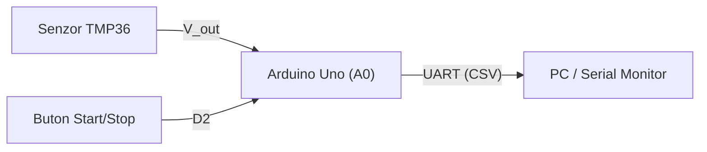

# Sistem de achiziție și monitorizare a temperaturii (APD)

Proiect de laborator pentru achiziția semnalelor analogice, filtrarea numerică și
transmiterea datelor pe interfața serială UART.

## Autor

**Bulearcă Mihnea-Ștefan --- Grupa 4LF341**

## 1. Hardware

IdeaPad Slim 3 16IAH8
Proccesor: Intel Core i5-12450H - up to 4.4 GHz.
Graphics: Integrated Intel UHD Graphics.
RAM Memory: 16GB LPDDR5-4800.
Stocare: SSD M.2 2242 PCIe 4.0 x4 NVMe 500GB.

## 2. Arhitectura sistemului



## 3. Alocarea pinilor (Pinout)

| Componentă    | Pin Arduino |   Configurație    | Rol                           |
| :------------ | :---------: | :---------------: | :---------------------------- |
| Senzor TMP36  |    `A0`     | Intrare analogică | Măsurare temperatură          |
| Buton control |    `D2`     |  `INPUT_PULLUP`   | Activare / oprire eșantionare |
| LED Stare     |    `D13`    |     `OUTPUT`      | Semnalizare achiziție activă  |

## 4. Relația de conversie

Pentru senzorul TMP36 ($500\text{ mV}$ offset la $0^\circ\text{C}$, pantă $10\text{
mV}/^\circ\text{C}$), temperatura în grade Celsius se calculează cu relația:
$$T(^\circ\text{C}) = \left( \frac{D_{ADC} \cdot 5.0}{1023.0} - 0.5 \right) \cdot 100$$

## 5. Formatul datelor transmise (CSV)

```text
timestamp_ms,raw_adc,voltage_v,temp_c
1000,153,0.75,24.78
2000,155,0.76,25.76
```

## 6. Checklist verificare

- [x] Configurare repository și `.gitignore`
- [x] Redactare specificație hardware în Markdown
- [ ] Simulare circuit în Tinkercad Circuits
